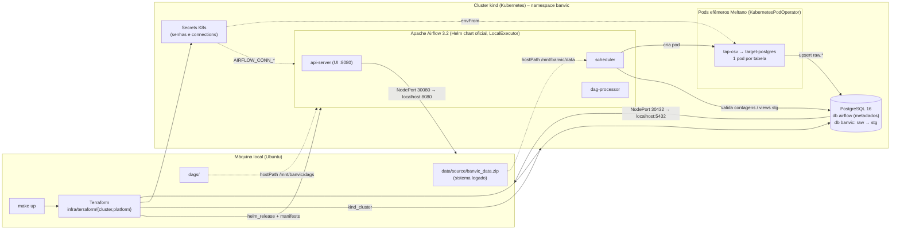
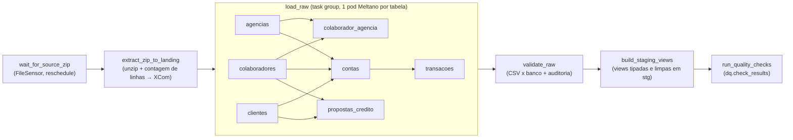

# BanVic Data Pipeline

Este repositório é a minha solução para o desafio da certificação **Data Engineer
by Indicium AI**: montar, do zero, a infraestrutura e o pipeline de ingestão do
Banco Vitória (BanVic), um banco fictício que entrega sete tabelas do ERP em CSV
dentro de um zip e precisa delas num lugar só, com orquestração, monitoramento
e tudo reproduzível por código.

Resolvi fazer tudo rodar na minha máquina, num cluster Kubernetes criado pelo
kind e descrito em Terraform. O Airflow orquestra, o Meltano extrai e carrega, o
PostgreSQL recebe. Não há nenhuma dependência de nuvem: quem clonar o repositório
e tiver Docker consegue subir o ambiente inteiro com um comando.

**Sumário**

1. [Arquitetura](#1-arquitetura)
2. [Pré-requisitos](#2-pré-requisitos)
3. [Subindo o ambiente passo a passo](#3-subindo-o-ambiente-passo-a-passo)
4. [Usando o pipeline no dia a dia](#4-usando-o-pipeline-no-dia-a-dia)
5. [Configurações: onde mudar cada coisa](#5-configurações-onde-mudar-cada-coisa)
6. [Estratégia de ingestão em detalhe](#6-estratégia-de-ingestão-em-detalhe)
7. [Análise exploratória e qualidade dos dados](#7-análise-exploratória-e-qualidade-dos-dados)
8. [Como a solução atende os critérios de avaliação](#8-como-a-solução-atende-os-critérios-de-avaliação)
9. [Troubleshooting](#9-troubleshooting)
10. [Estrutura do repositório](#10-estrutura-do-repositório)
11. [Limitações e próximos passos](#11-limitações-e-próximos-passos)

---

## 1. Arquitetura



### Fluxo da DAG `banvic_ingestion`



### Por que escolhi cada ferramenta

| Camada | Ferramenta | Motivo |
|---|---|---|
| Kubernetes local | **kind 0.33** | Sobe em menos de um minuto e só precisa do Docker. O que me convenceu foram dois recursos: `extraMounts`, que coloca pastas do repositório dentro do nó, e `extraPortMappings`, que expõe a UI e o banco em `localhost` sem port-forward. O minikube também está instalado e serviria; o kind é mais leve. |
| IaC | **Terraform 1.16** com os providers `tehcyx/kind`, `hashicorp/kubernetes` e `hashicorp/helm` | Cluster, namespace, Secrets, Postgres e Airflow declarados em código, e `terraform destroy` desfaz tudo. Separei em dois roots (`cluster/` e `platform/`) porque os providers de Kubernetes e Helm precisam de um kubeconfig que só existe depois que o cluster nasce. |
| Orquestração | **Apache Airflow 3.2.2** via chart oficial 1.22, com `LocalExecutor` | O chart oficial é o caminho suportado para Kubernetes. Fiquei no LocalExecutor para não trazer Redis e Celery para uma POC; o trabalho pesado não roda no scheduler mesmo, roda em pods próprios via `KubernetesPodOperator`. |
| Ingestão | **Meltano 4.4** com `tap-csv` e `target-postgres` (variantes MeltanoLabs) | Extractors e loaders declarativos num único `meltano.yml`, chave primária por tabela, `load_method: upsert` para a carga ser idempotente e colunas `_sdc_*` que dizem de onde veio cada linha. Empacotei numa imagem Docker própria, com os plugins fixados em versão. |
| Destino | **PostgreSQL 16** | O desafio dava a escolha entre Postgres e MinIO. Os dados são tabulares, pequenos e com esquema conhecido, então um warehouse relacional faz mais sentido que um lake. Um servidor, dois bancos e dois usuários: `airflow` para metadados e `banvic` para o DW, com os esquemas `raw` e `stg`. |
| Segredos | **Kubernetes Secrets** gerados pelo Terraform a partir de um `.env` | Nenhuma senha em código, chart, DAG ou `meltano.yml`. |
| Automação | **Makefile** | Um comando por etapa do ciclo de vida: `up`, `down`, `status`, `trigger`, `psql`. |

### Por que dois bancos no mesmo Postgres

O Airflow guarda os próprios metadados (DAGs, runs, XComs, usuários) num banco, e
eu não queria misturar isso com os dados do BanVic. Separar dá isolamento (uma
consulta pesada de analista não compete com o scheduler, e recriar o Airflow não
toca nos dados de negócio) e dá segurança (o usuário `airflow` só enxerga o banco
`airflow`, o usuário `banvic` só enxerga o `banvic`, e nenhum dos dois consegue
sequer conectar no banco do outro). Compartilhar o mesmo servidor é só para
economizar recursos na POC; em produção seriam instâncias separadas.

---

## 2. Pré-requisitos

| Ferramenta | Versão testada | Para quê |
|---|---|---|
| Docker Engine | 29.x | o kind roda os nós como containers; build da imagem do Meltano |
| kind | 0.33 | cluster Kubernetes local |
| kubectl | 1.37 | inspecionar o cluster |
| Helm | 3.22 | o provider do Terraform usa a biblioteca; o CLI ajuda a depurar |
| Terraform | 1.16 | IaC |
| make, python3, openssl | qualquer | Makefile, checagem de sintaxe, gerar senhas |
| psql (opcional) | 18 | `make psql` |
| DBeaver (opcional) | CE | explorar os dados |

Em hardware, conte com 8 GB de RAM livres e uns 5 GB de disco para as imagens.
Desenvolvi e testei em um Ubuntu 26.04 com 8 CPUs e 14 GB.

Seu usuário precisa estar no grupo `docker` (`sudo usermod -aG docker $USER`,
depois logout e login).

Se você estiver em Ubuntu, deixei um script que instala tudo isso a partir dos
repositórios oficiais (Docker, HashiCorp, dl.k8s.io e releases do GitHub):

```bash
bash scripts/install-tools-ubuntu.sh
```

---

## 3. Subindo o ambiente passo a passo

### 3.1 Clonar e configurar os segredos

```bash
git clone <este-repositório>
cd banvic-pipeline
cp .env.example .env
```

Edite o `.env` com as senhas que quiser, ou gere uma aleatória diferente para
cada variável:

```bash
for v in postgres_admin airflow_db banvic_dw airflow_admin; do sed -i "s/^\(TF_VAR_${v}_password=\).*/\1$(openssl rand -hex 12)/" .env; done
```

O `.env` está no `.gitignore` e nunca vai para o repositório. O Makefile lê esse
arquivo e exporta as variáveis `TF_VAR_*`, que o Terraform recebe como variáveis
`sensitive`.

| Variável | Quem usa |
|---|---|
| `TF_VAR_postgres_admin_password` | superusuário `postgres` (o init script usa; trate como qualquer senha de admin) |
| `TF_VAR_airflow_db_password` | usuário `airflow`, banco de metadados |
| `TF_VAR_banvic_dw_password` | usuário `banvic`, banco analítico (Meltano, DAG, DBeaver) |
| `TF_VAR_airflow_admin_password` | usuário `admin` da UI do Airflow |

> **Sobre o UID dos pods.** O Airflow roda com o UID do seu usuário (padrão 1000)
> para conseguir escrever em `data/landing`, que é uma pasta do host montada no
> cluster. Se `id -u` devolver outro número, crie
> `infra/terraform/platform/terraform.tfvars` com `airflow_uid = <seu uid>`.

### 3.2 Subir tudo

```bash
make up
```

Por baixo, isso roda três etapas em sequência:

| Etapa | Comando | O que acontece | Tempo |
|---|---|---|---|
| 1 | `make cluster` | `terraform apply` em `infra/terraform/cluster`: cria o kind `banvic`, monta `dags/` e `data/` no nó, mapeia as portas 8080 e 5432 e grava o `.kubeconfig` na raiz | ~1 min |
| 2 | `make images` | `docker build` da imagem `banvic/meltano:local` e `kind load` para dentro do nó | 2 a 5 min na primeira vez |
| 3 | `make platform` | `terraform apply` em `infra/terraform/platform`: namespace, Secrets, Postgres, PV das DAGs e `helm_release` do Airflow; depois espera o rollout terminar | 3 a 5 min |
| 4 | `make status` | lista os pods | |

Na primeira vez o total fica entre 5 e 10 minutos, quase tudo download de imagem
(a do Airflow tem cerca de 1 GB). Nas seguintes, uns 3 minutos.

### 3.3 Conferir que está no ar

```bash
make status
```

O que você deve ver (os dois `Completed` são os jobs de migração e de criação do
usuário inicial, que rodam uma vez e somem depois):

```
airflow-api-server-...      1/1   Running
airflow-dag-processor-...   2/2   Running
airflow-scheduler-0         2/2   Running
airflow-create-user-...     0/1   Completed
airflow-run-airflow-migr... 0/1   Completed
postgres-...                1/1   Running
```

### 3.4 Acessar o Airflow

- URL: <http://localhost:8080>
- Usuário: `admin`
- Senha: o valor de `TF_VAR_airflow_admin_password` no seu `.env`
  (`grep airflow_admin_password .env`)

### 3.5 Rodar o pipeline

Pela UI: abra a DAG `banvic_ingestion`, ligue o toggle (ela nasce pausada) e
clique em **Trigger**. Ou pela linha de comando:

```bash
make trigger
```

Uma execução completa leva perto de um minuto. Vale abrir outro terminal para ver
os pods do Meltano nascendo e morrendo:

```bash
export KUBECONFIG=$PWD/.kubeconfig
kubectl -n banvic get pods -w
```

### 3.6 Verificar os dados no destino

```bash
make psql     # usuário banvic, senha = TF_VAR_banvic_dw_password
```

```sql
-- auditoria da última execução (deve ter 7 linhas, todas 'ok')
SELECT table_name, csv_rows, db_rows, status, validated_at
FROM dq.ingestion_audit
WHERE run_id = (SELECT run_id FROM dq.ingestion_audit ORDER BY validated_at DESC LIMIT 1)
ORDER BY table_name;

-- camada bruta (texto + colunas _sdc_* de rastreabilidade)
SELECT * FROM raw.transacoes LIMIT 5;

-- camada staging (tipada)
SELECT nome_transacao, COUNT(*), SUM(valor_transacao)
FROM stg.transacoes GROUP BY 1 ORDER BY 2 DESC;
```

No **DBeaver**: nova conexão PostgreSQL, host `localhost`, porta `5432`, banco
`banvic`, usuário `banvic`, senha do `.env`.

A auditoria deve bater exatamente assim:

| table_name | csv_rows | db_rows | status |
|---|---|---|---|
| agencias | 10 | 10 | ok |
| clientes | 998 | 998 | ok |
| colaborador_agencia | 100 | 100 | ok |
| colaboradores | 100 | 100 | ok |
| contas | 999 | 999 | ok |
| propostas_credito | 2000 | 2000 | ok |
| transacoes | 71999 | 71999 | ok |

### 3.7 Derrubar tudo

```bash
make down
```

Destrói a plataforma e o cluster. O `.env` e o zip de origem ficam, então para
subir de novo basta `make up`.

---

## 4. Usando o pipeline no dia a dia

### Comandos do Makefile

| Comando | O que faz |
|---|---|
| `make help` | lista os alvos |
| `make up` | cluster + imagens + plataforma |
| `make cluster` | só o cluster kind |
| `make images` | rebuild da imagem do Meltano e reload no kind |
| `make platform` | aplica Postgres, Secrets e Airflow (idempotente; use depois de mudar a infra) |
| `make status` | pods do namespace `banvic` |
| `make trigger` | despausa e dispara a DAG |
| `make logs` | logs do scheduler em tempo real |
| `make psql` | abre psql no banco analítico |
| `make ui` | lembra a URL da UI |
| `make down` | destrói tudo |

Para usar `kubectl` e `helm` diretamente, aponte para o kubeconfig do projeto:

```bash
export KUBECONFIG=$PWD/.kubeconfig
kubectl -n banvic get pods
helm -n banvic list
```

### Situações comuns

**Alterei a DAG.** Só salvar o arquivo em `dags/`. A pasta é montada direto no
cluster e o dag-processor relê a cada 30 segundos (`refresh_interval`). Se houver
erro de importação, ele aparece num banner no topo da UI, ou com:

```bash
kubectl -n banvic exec deploy/airflow-dag-processor -c dag-processor -- airflow dags list-import-errors
```

**Alterei o `meltano.yml` ou os plugins.** A configuração vai dentro da imagem,
então é preciso reconstruir e recarregar:

```bash
make images
```

Os pods seguintes já usam a imagem nova. Isso funciona com a mesma tag porque o
`kind load` substitui a imagem no nó e o `image_pull_policy` é `IfNotPresent`.

**Alterei Terraform ou os values do Helm.** `make platform`. O Helm faz o upgrade
e os pods do Airflow reiniciam.

**Chegou um zip novo.** Substitua `data/source/banvic_data.zip` e dispare a DAG.
Uma ressalva importante: o zip precisa ser um **snapshot completo** das sete
tabelas. Linhas novas entram e as existentes são atualizadas pela chave primária,
mas linhas que sumiram da fonte não são apagadas no destino, e a validação exige
que a contagem do CSV seja igual à do banco. Se um dia a fonte passar a mandar
deltas, a validação teria que virar `db_rows >= csv_rows`, ou entraria um soft
delete.

**Quero ver o log de uma task.** Na UI: DAG, Grid, clique na task, Logs. O log
dos pods Meltano é capturado pelo `KubernetesPodOperator` e aparece ali também,
inclusive a métrica `record_count` do target.

**Quero rodar o Meltano fora do cluster**, para depurar o tap ou o target:

```bash
cd ingestion/meltano
uv tool install --python 3.12 meltano    # ou pipx install meltano
meltano install
source ../../.env
export TARGET_POSTGRES_HOST=localhost TARGET_POSTGRES_PORT=5432 \
       TARGET_POSTGRES_USER=banvic TARGET_POSTGRES_PASSWORD="$TF_VAR_banvic_dw_password" \
       TARGET_POSTGRES_DATABASE=banvic
meltano el tap-csv target-postgres --select 'agencias.*'
```

O symlink `ingestion/meltano/data -> ../../data` é o que faz o mesmo
`meltano.yml` funcionar tanto na máquina quanto no container.

**Quero zerar o banco analítico.** `make down && make up` recria o volume. Para
limpar só as tabelas e manter o resto:

```sql
DROP SCHEMA raw CASCADE; DROP SCHEMA stg CASCADE;
CREATE SCHEMA raw; CREATE SCHEMA stg;
```

---

## 5. Configurações: onde mudar cada coisa

| Quero mudar... | Arquivo | Campo |
|---|---|---|
| Senhas | `.env` | `TF_VAR_*`. Trocar senha exige `make down && make up`, porque o Postgres só cria os usuários no primeiro boot do volume |
| Porta da UI ou do Postgres no host | `infra/terraform/cluster/variables.tf` | `airflow_host_port`, `postgres_host_port` |
| Versão do Kubernetes | `infra/terraform/cluster/variables.tf` | `node_image` |
| Nome do cluster | `infra/terraform/cluster/variables.tf` e `Makefile` | `cluster_name`, `CLUSTER` |
| Versão do chart do Airflow | `infra/terraform/platform/variables.tf` | `airflow_chart_version` |
| UID dos pods do Airflow | `infra/terraform/platform/variables.tf` | `airflow_uid` |
| Executor, timezone, recursos, componentes do Airflow | `infra/terraform/platform/airflow-values.yaml` | values do chart |
| Recursos ou imagem do Postgres | `infra/terraform/platform/postgres.tf` | `resources`, `image` |
| Usuários e esquemas iniciais do Postgres | `infra/terraform/platform/postgres.tf` | ConfigMap `postgres-init` |
| Tabelas, chaves primárias, caminhos dos CSVs | `ingestion/meltano/meltano.yml` | `files` |
| Esquema de destino, método de carga | `ingestion/meltano/meltano.yml` | `default_target_schema`, `load_method` |
| Versão do Meltano | `ingestion/meltano/Dockerfile` | `FROM` |
| Agendamento, retries, dependências entre tabelas | `dags/banvic_ingestion.py` | `schedule`, `DEFAULT_ARGS`, `TABLES` |
| Tipagem e limpeza da camada staging | `dags/sql/stg_views.sql` | views |
| Checks de qualidade | `dags/sql/dq_checks.sql` | um `SELECT` por check. O arquivo passa pelo psycopg2 com o parâmetro `%(run_id)s`, então qualquer `%` literal precisa ser escrito `%%` |
| Imagem, namespace e Secret usados pela DAG | `infra/terraform/platform/variables.tf` (`meltano_image`) | chegam à DAG pelas variáveis `BANVIC_*` injetadas pelo chart |

### Como os segredos chegam a cada componente

```
.env  ──(Makefile: include + export)──▶  TF_VAR_*  ──▶  variáveis sensitive do Terraform
                                                            │
        ┌───────────────────────────────────────────────────┼─────────────────────────┐
        ▼                                                   ▼                         ▼
Secret postgres-credentials                    Secret airflow-metadata        Secret meltano-target-postgres
(envFrom no pod do Postgres;                   (chart: data.metadataSecretName) (envFrom nos pods Meltano:
 o init script cria os usuários)                                                 TARGET_POSTGRES_*)
                                                            ▼
                                               Secret airflow-connections
                                               (extraEnvFrom: AIRFLOW_CONN_BANVIC_DW, AIRFLOW_CONN_FS_DEFAULT)
```

O state local do Terraform (`*.tfstate`) carrega os valores sensíveis, então
também está no `.gitignore`.

Algumas outras decisões de segurança: o init script do Postgres revoga o
`CONNECT` de `PUBLIC` nos dois bancos e concede só ao dono de cada um; o kind
publica as portas 8080 e 5432 apenas em `127.0.0.1`, então nada fica exposto na
rede local; e os pods Meltano montam o landing somente leitura, com limites de
CPU e memória.

---

## 6. Estratégia de ingestão em detalhe

**A fonte.** `data/source/banvic_data.zip` faz o papel do sistema legado que
entrega arquivos. A pasta `data/` do repositório é montada no nó kind em
`/mnt/banvic/data` e daí nos pods: `/opt/airflow/data` para o Airflow,
`/project/data` para o Meltano.

**1. Sensor.** `wait_for_source_zip` é um `FileSensor` em `mode="reschedule"`,
checando a cada 30 segundos por até 30 minutos. Em modo reschedule a task
devolve o slot do executor enquanto espera, em vez de ficar ocupando.

**2. Extração para o landing.** `extract_zip_to_landing` descompacta num
diretório temporário dentro de `data/landing`, confere que os sete CSVs esperados
estão lá (e falha cedo se faltar algum), conta as linhas com `csv.reader`, que
respeita quebras de linha dentro de aspas, e move cada arquivo com `os.replace`,
que é atômico. O landing nunca fica pela metade. As contagens seguem por XCom
para a validação.

**3. Carga bruta.** O task group `load_raw` abre um pod Meltano por tabela,
rodando `meltano el tap-csv target-postgres --select <tabela>.*`. A ordem segue
as chaves estrangeiras: dimensões antes de `contas`, `contas` antes de
`transacoes`. Isso deixa o grafo pronto para checagens de integridade referencial
no futuro e, de quebra, permite paralelismo onde não há dependência.

- **Integridade.** O `meltano.yml` declara a chave primária de cada entidade
  (`keys`) e o `target-postgres` usa `load_method: upsert`. Rodar de novo não
  duplica.
- **Rastreabilidade.** `add_metadata_columns` grava `_sdc_source_file`,
  `_sdc_source_file_mtime` e `_sdc_source_lineno`; `add_record_metadata` grava
  `_sdc_extracted_at`, `_sdc_received_at`, `_sdc_batched_at` e afins.
- **Tipagem.** O `tap-csv` entrega tudo como texto, e isso é proposital: a
  camada `raw` é uma cópia fiel da fonte. As conversões ficam nas views `stg.*`.
- **Isolamento.** Cada pod tem requests e limits de CPU e memória, é removido ao
  terminar e só enxerga o landing em modo somente leitura.

**4. Validação.** `validate_raw` compara, tabela a tabela, as linhas do CSV com o
`COUNT(*)` em `raw.<tabela>`, grava o resultado em `dq.ingestion_audit` (chave
`run_id + tabela`, com upsert) e derruba a DAG se houver divergência.

**5. Staging.** `build_staging_views` executa `dags/sql/stg_views.sql`, que
recria as views com `DROP VIEW IF EXISTS` seguido de `CREATE VIEW`. Sem
`CASCADE`, de propósito: se alguém criar objetos em cima de `stg.*`, a task falha
em vez de apagá-los em silêncio. As views fazem os casts para `integer`,
`numeric`, `date` e `timestamptz` e aplicam as regras de limpeza da seção 7. É a
camada que um analista, ou um futuro projeto dbt, consumiria.

**6. Qualidade.** `run_quality_checks` executa `dags/sql/dq_checks.sql`, que
grava um resultado por check em `dq.check_results` (chave `run_id + check`).
Checks de severidade `error` derrubam a DAG; `warn` e `info` ficam só no log e
na tabela.

### Monitoramento e tolerância a falhas

- `retries=2` com backoff exponencial em todas as tasks, via `default_args`.
  As duas tasks cujas falhas são determinísticas (validação e qualidade) usam
  `retries=0`, porque tentar de novo não mudaria o resultado.
- `max_active_runs=1` e `catchup=False`: uma execução por vez, sem corrida.
- Os pods Meltano são removidos ao terminar (`on_finish_action="delete_pod"`),
  com `startup_timeout_seconds=300` e eventos do pod no log quando dá errado.
- `dq.ingestion_audit` é o histórico auditável de cada execução.
- A UI do Airflow mostra falhas por task, tentativas e logs. O scheduler serve
  os logs das tasks direto pela porta `worker-logs`, sem volume compartilhado.
- Tudo é idempotente: landing sobrescrito, upsert por chave, views recriadas,
  Terraform e Helm declarativos. Rodei a DAG várias vezes seguidas e as contagens
  não mudam.

---

## 7. Análise exploratória e qualidade dos dados

### 7.1 Perfil do dataset

Antes de desenhar a camada `stg`, perfilei os sete CSVs com SQL sobre a camada
`raw`: contagens, distintos, nulos, formatos por regex, integridade referencial,
regras de negócio e distribuição no tempo. O resumo:

| Tabela | Linhas | Chave | Período | O que é |
|---|---|---|---|---|
| `agencias` | 10 | `cod_agencia` | aberturas de 2010 a 2021 | 9 agências físicas (SP, RS, RJ, SC, PE) e 1 digital |
| `clientes` | 998 | `cod_cliente` | inclusão de 2010-02 a 2022-12 | 100% PF, nascidos entre 1942 e 2007 |
| `colaboradores` | 100 | `cod_colaborador` | nascidos entre 1962 e 1998 | 1 agência por colaborador |
| `colaborador_agencia` | 100 | `(cod_colaborador, cod_agencia)` | | vínculo colaborador x agência |
| `contas` | 999 | `num_conta` | abertura de 2010-02 a 2022-12 | 1 conta por cliente, 100% PF; 46% na Agência Digital |
| `propostas_credito` | 2.000 | `cod_proposta` | 2010-01 a 2022-12 | 4 status equilibrados (Enviada, Aprovada, Validação documentos, Em análise); taxa média 1,65% a.m. |
| `transacoes` | 71.999 | `cod_transacao` | 2010-02 a 2023-01 | 15 tipos; saídas negativas, entradas positivas |

Transações por tipo (o sinal do valor é coerente com o tipo em 100% das linhas):

| Tipo | Linhas | Natureza |
|---|---|---|
| Compra Crédito | 24.977 | débito |
| Compra Débito | 17.662 | débito |
| Pix - Realizado | 13.164 | débito |
| Pix - Recebido | 5.134 | crédito |
| Depósito em espécie | 4.866 | crédito |
| Saque | 2.879 | débito |
| TED - Recebido | 1.005 | crédito |
| demais 8 tipos | 2.312 | |

No tempo, o volume cresce ano a ano (93 transações em 2010, 7.777 em 2021) e
então **salta para 36.506 em 2022**, concentradas em 29/12 (13.825) e 30/12
(6.612). Pela hora UTC, 23h e 0h concentram 31% das linhas; em horário de
Brasília isso vira 20h e 21h. Esse pico é a principal armadilha do dataset, e
qualquer média diária que não o trate sai errada.

### 7.2 Armadilhas encontradas e o que fiz com elas

A exploração revelou uma série de problemas na fonte, alguns claramente
plantados. Minha regra foi: **a camada `raw` é uma cópia fiel**, nada é alterado
nem descartado; **a camada `stg` limpa e normaliza**; e **cada anomalia vira uma
coluna `flag_*`**, para o analista decidir o que fazer, além de ser contada a cada
execução em `dq.check_results`.

| # | Armadilha | Onde | Tratamento em `stg` | Check em `dq` |
|---|---|---|---|---|
| 1 | **Timestamps em UTC** com sufixo literal (`2020-05-22 03:15:21 UTC`). Analisar por dia ou hora em UTC distorce o resultado (23h UTC é 20h em Brasília). | todas as datas-hora | Cast para `timestamptz` e coluna extra `*_local` em `America/Sao_Paulo`; `transacoes` ganha `data_transacao_dia_local` | |
| 2 | **Pico artificial de transações**: 28% delas (20.437 de 71.999) caem em dois dias, 29 e 30/12/2022, e 2022 sozinho tem metade do histórico. | `transacoes` | Mantido; sinalizado como `warn` para o analista excluir ou tratar | `transacoes_concentracao_diaria` |
| 3 | **CEP em dois formatos** (`95140-704` e `51779625`), em 48% dos clientes e 47% dos colaboradores | `clientes.cep`, `colaboradores.cep` | Normalizado para `99999-999`; original em `cep_raw`; `flag_cep_invalido` quando não tem 8 dígitos | `*_cep_sem_hifen_na_fonte` |
| 4 | **Cliente fantasma**: `cod_cliente = 528` existe em `contas` (1 linha) e em `propostas_credito` (4) mas não em `clientes`, que tem 998 clientes com códigos até 999 | `contas`, `propostas_credito` | `flag_cliente_inexistente` (LEFT JOIN, linha mantida) | `contas_cliente_inexistente`, `propostas_cliente_inexistente` |
| 5 | **E-mail compartilhado** por clientes diferentes (4 pares, CPFs distintos) | `clientes` | `flag_email_duplicado` | `clientes_email_duplicado` |
| 6 | **`saldo_disponivel > saldo_total`** em 248 contas (25%) | `contas` | `flag_disponivel_maior_que_total` | `contas_saldo_disponivel_maior_que_total` |
| 7 | **Semântica invertida nos valores da proposta**: em 100% das linhas `valor_financiamento = valor_proposta + valor_entrada`. Ou seja, `valor_proposta` é a parte financiada e `valor_financiamento` é o total. | `propostas_credito` | Mantive os nomes da fonte; `valor_total_calculado` deixa a relação explícita e `flag_valores_inconsistentes` marca linhas que fujam dela | `propostas_financiamento_igual_proposta_mais_entrada` |
| 8 | **Artefatos de ponto flutuante** (`2984.7614999999996`) em 91% dos saldos e nos valores de proposta | `contas`, `propostas_credito` | `round(..., 2)`; taxa com 6 casas | `contas_saldo_com_artefato_float` |
| 9 | **Categoria sem acento**: `Estorno de Debito` (403 linhas) ao lado de `Compra Débito` | `transacoes.nome_transacao` | Padronizado para `Estorno de Débito`; coluna `natureza` (Crédito/Débito pelo sinal) e `valor_absoluto` | `transacoes_nome_sem_acento_na_fonte`, `transacoes_sinal_inconsistente` |
| 10 | **O CEP dentro do endereço nunca bate com a coluna `cep`** (dado sintético: `... 81327-166 ... / SP` com `cep = 95140-704`). O endereço não serve para geolocalizar. | `clientes.endereco`, `colaboradores.endereco` | Mantido como texto; documentado | |
| 11 | **Concentração na Agência Digital**: 46% das contas (460 de 999) | `contas` | Nenhum; é característica do negócio, não erro | |

### 7.3 O que conferi e está consistente

Não há duplicata de chave primária em nenhuma tabela, nem nulos ou vazios. Não há
transações órfãs, duplicadas logicamente (mesma conta, data, tipo e valor) ou
anteriores à abertura da conta. Nenhum cliente ou colaborador é menor de idade,
nenhum cliente foi incluído depois de abrir a conta. O sinal do valor bate com o
tipo em 100% das transações. Cada cliente tem uma conta, cada colaborador tem uma
agência, e `conta.cod_agencia` coincide com a agência do colaborador em 100% das
contas. CPFs são únicos e todos no formato `999.999.999-99`. Parcelas, carência e
taxas estão em faixas plausíveis.

### 7.4 Como reproduzir a exploração

Todas as verificações acima estão codificadas em `dags/sql/dq_checks.sql` e rodam
a cada execução da DAG. Para explorar por conta própria, conecte no banco
`banvic` (`make psql` ou DBeaver) e use a camada `stg`, que já vem com tipos
corretos, horário local e as colunas `flag_*`.

Duas consultas que uso bastante:

```sql
-- resultado dos checks da última run
SELECT check_name, severity, failed_rows, total_rows, detail
FROM dq.check_results
WHERE run_id = (SELECT run_id FROM dq.check_results ORDER BY checked_at DESC LIMIT 1)
ORDER BY severity, check_name;

-- transações por dia local, excluindo o pico artificial
SELECT data_transacao_dia_local, COUNT(*), SUM(valor_transacao)
FROM stg.transacoes
WHERE data_transacao_dia_local NOT IN ('2022-12-29', '2022-12-30')
GROUP BY 1 ORDER BY 1;
```

---

## 8. Como a solução atende os critérios de avaliação

| Critério | Como atendo | Onde ver |
|---|---|---|
| **a) Domínio de infraestrutura** (Docker, Terraform, Kubernetes, isolamento, reprodutibilidade) | Cluster kind criado por Terraform; Postgres e Airflow também como recursos Terraform (manifests e `helm_release`); imagem Docker própria do Meltano; namespace dedicado; `make up` e `make down` recriam tudo do zero | `infra/terraform/`, `ingestion/meltano/Dockerfile`, `Makefile` |
| **b) Implementação da ingestão** (taps/targets, conexões, movimentação eficiente) | Meltano com `tap-csv` e `target-postgres`, chave primária por entidade, upsert, metadados `_sdc_*`; sete cargas em pods paralelos respeitando dependências; credenciais do target por Secret | `ingestion/meltano/meltano.yml`, `dags/banvic_ingestion.py` (task group `load_raw`) |
| **c) Orquestração e boas práticas de Airflow** (DAGs organizadas, operadores corretos, dependências, agendamento) | DAG com `doc_md`, tags, `schedule="@daily"`, `catchup=False`, `max_active_runs=1`; `FileSensor` em reschedule; `@task` para Python; `KubernetesPodOperator` para o trabalho pesado; `SQLExecuteQueryOperator` para SQL; task group com dependências explícitas | `dags/banvic_ingestion.py` |
| **d) Qualidade e resiliência do código** (limpo, modular, trata erros) | Constantes e tabela de dependências no topo; funções pequenas; validação que falha explicitamente; retries com backoff onde faz sentido; extração atômica; auditoria persistida; checks de qualidade com severidade | `dags/banvic_ingestion.py`, `dags/sql/stg_views.sql`, `dags/sql/dq_checks.sql` |
| **e) Segurança e gerenciamento de segredos** | Nenhuma credencial em código ou chart; `.env` ignorado pelo git; variáveis `sensitive` no Terraform; Secrets do Kubernetes; connections do Airflow por `AIRFLOW_CONN_*`; usuários de banco separados e sem `CONNECT` no banco do outro; portas publicadas só em `127.0.0.1` | `.env.example`, `.gitignore`, `infra/terraform/platform/{variables,airflow,postgres}.tf` |
| **f) Apresentação da solução** | Este README (diagramas, escolhas, passo a passo) e o roteiro do vídeo | `README.md`, `docs/roteiro-video.md` |

E as etapas do desafio:

| Etapa | Entrega |
|---|---|
| 1. IaC, containers e Kubernetes | Terraform (`cluster/` + `platform/`), kind, Docker, Helm |
| 2. Pipeline de ingestão (ELT) com Meltano | `ingestion/meltano/`, taps e targets configurados com chaves |
| 3. Orquestração com DAGs | `dags/banvic_ingestion.py`: sensor, task group, dependências |
| 4. Monitoramento e tratamento de falhas | retries, idempotência, auditoria, checks de qualidade em `dq.check_results`, logs na UI |
| 5. Documentação técnica | este README |
| 6. Apresentação e vídeo | `docs/roteiro-video.md` |

---

## 9. Troubleshooting

Problemas que eu mesmo encontrei construindo isso, e como resolvi.

**`make platform` trava ou dá timeout no `helm_release`.** O chart do Airflow
roda as migrações como Helm hook pós-instalação. Se o Terraform estiver com
`wait = true`, vira um impasse: os pods esperam a migração, o Terraform espera os
pods. Por isso o `helm_release` usa `wait = false` e o Makefile espera o rollout
com `kubectl`. Se você mudou isso, volte.

**`extract_zip_to_landing` falha com `PermissionError`.** Os pods do Airflow
precisam rodar com o UID do dono da pasta `data/` no host. Ajuste `airflow_uid`
(seção 3.1) e rode `make platform`.

**Pods do Airflow ficam `Pending` e aparece um PVC `airflow-logs` também `Pending`.**
Alguém ligou `logs.persistence` nos values. O provisionador do kind só suporta
ReadWriteOnce, e não é necessário: com LocalExecutor o scheduler serve os logs.

**`helm upgrade` falha com `field is immutable` num Job.** Acontece se os jobs do
chart forem configurados com `useHelmHooks: false`. Mantenha os hooks (que é o
padrão) e `wait = false`.

**Porta 8080 ou 5432 já em uso.** Mude `airflow_host_port` ou
`postgres_host_port` em `infra/terraform/cluster/variables.tf` e recrie o cluster
com `make down && make up`.

**`docker: permission denied`.** Seu usuário não está no grupo `docker`. Depois
do `usermod`, faça logout e login, ou `newgrp docker`.

**Pod Meltano com `ErrImageNeverPull` ou `ImagePullBackOff`.** A imagem não foi
carregada no kind. `make images`.

**A UI não abre em localhost:8080.** Confira `kubectl -n banvic get svc
airflow-api-server` (tem que ser NodePort 30080) e `docker ps` (a porta 8080 deve
estar mapeada no container `banvic-control-plane`).

**A sessão da UI caiu depois de um `make platform`.** O chart regenera a chave
de sessão quando o api-server reinicia. É só logar de novo.

**Para ver por que um pod falhou:**

```bash
export KUBECONFIG=$PWD/.kubeconfig
kubectl -n banvic describe pod <nome>
kubectl -n banvic logs <nome> -c <container>
```

---

## 10. Estrutura do repositório

```
.
├── Makefile                          # up / down / status / trigger / psql
├── .env.example                      # modelo dos segredos (TF_VAR_*)
├── .gitignore                        # .env, state, kubeconfig, landing, .meltano
├── README.md
├── dags/
│   ├── banvic_ingestion.py           # a DAG
│   └── sql/
│       ├── stg_views.sql             # views tipadas e limpas (stg)
│       └── dq_checks.sql             # checks de qualidade (dq.check_results)
├── data/
│   ├── source/banvic_data.zip        # fonte (sistema legado)
│   └── landing/                      # CSVs extraídos (gerado, ignorado pelo git)
├── docs/
│   └── roteiro-video.md              # roteiro da apresentação
├── ingestion/meltano/
│   ├── meltano.yml                   # tap-csv + target-postgres
│   ├── plugins/                      # lockfiles dos plugins (versões fixadas)
│   ├── Dockerfile                    # imagem banvic/meltano:local
│   └── data -> ../../data            # symlink para testes locais
├── infra/terraform/
│   ├── cluster/                      # kind: mounts, portas (só localhost), versão do K8s
│   │   ├── main.tf  variables.tf  outputs.tf
│   └── platform/                     # tudo dentro do cluster
│       ├── providers.tf              # kubernetes + helm via .kubeconfig
│       ├── variables.tf              # segredos (sensitive) e parâmetros
│       ├── postgres.tf               # namespace, secret, init, PVC, deployment, services
│       ├── airflow.tf                # secrets do Airflow/Meltano, PV das DAGs, helm_release
│       └── airflow-values.yaml       # values do chart (templatefile)
└── scripts/
    └── install-tools-ubuntu.sh       # instala Docker, kind, kubectl, Helm, Terraform...
```

---

## 11. Limitações e próximos passos

Isto é uma POC local e tem as limitações de uma: sem alta disponibilidade,
storage em hostPath e local-path, uma réplica de cada coisa. Os logs das tasks
ficam no pod do scheduler e somem com ele; em produção iriam para storage remoto.

A camada `stg` é feita de views. O passo natural seguinte seria dbt por cima
dela, com modelos materializados, testes e documentação, e a modelagem
dimensional que o grafo da DAG já antecipa ao carregar dimensões antes dos fatos.

Outras evoluções que considerei e deixei fora do escopo: MinIO como data lake de
landing, Great Expectations na validação, alertas em Teams ou Slack via
`on_failure_callback`, git-sync das DAGs direto do GitHub, e um CI com
`terraform validate` e teste de importação da DAG.
